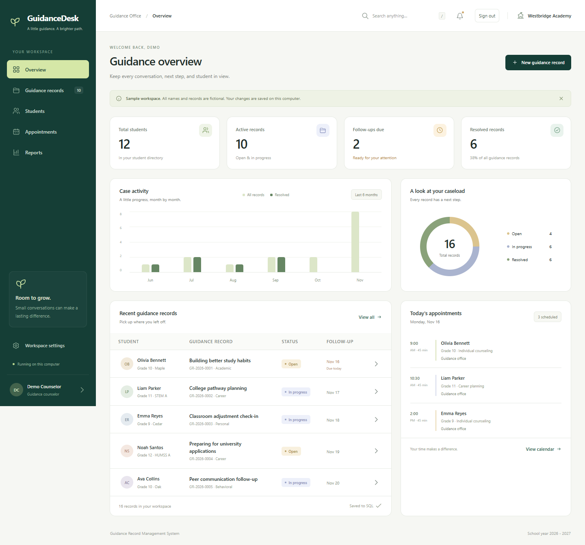

# GuidanceDesk

An independent Java and SQL portfolio application for managing student guidance records, case notes, follow-ups, appointments, and reports. Runs locally with a browser interface and an embedded H2 database.



## Start

**Windows:** double-click **Start GuidanceDesk.cmd**, keep the command window open, then create your owner account in the browser at **http://127.0.0.1:8787**.

- Java 17+ is required. The runnable distribution includes the compiled app and database library.
- The GitHub source distribution needs **JDK 17+** for its first build. Its launcher builds the missing JAR and downloads H2 once from Maven Central with SHA-256 verification.
- Choose your own username and a 15–128-character passphrase. No default login is supplied. Keep this passphrase somewhere safe; there is no email recovery service.
- The default workspace starts with **12 fictional students and 16 sample records**. Record data stays on your computer.
- **Start blank workspace.cmd** opens a separate empty workspace on port **8788**, preserving the sample workspace.
- Press **Ctrl+C** in the app's command window to stop.

From PowerShell:

```powershell
./build.ps1
java --add-modules jdk.httpserver -jar ./guidancedesk.jar --open-browser
```

For a separate empty workspace:

```powershell
java --add-modules jdk.httpserver -jar ./guidancedesk.jar --data ./another-workspace --port 8790 --empty --open-browser
```

`--empty` only suppresses sample data for a new database; it does not clear existing records. `--no-browser` avoids opening a browser window. Dates and appointment times use **Asia/Manila**. PowerShell 7+ supports the build/test scripts on Linux and macOS; Windows launchers use Windows PowerShell. The app itself only needs Java. An optional Maven build is available with `mvn package`, followed by `java --add-modules jdk.httpserver -jar target/guidancedesk.jar`.

## Features

- Student directory with add/edit, search, grade filters, and guidance history.
- Guidance records with category, priority, status, counselor, summary, and follow-up date.
- Dated case notes attributed to the signed-in owner; resolve/reopen and archive/restore.
- Global search, record filtering, appointment calendar, overlap checks, rescheduling, completion, and cancellation.
- Dashboard counts, date-filtered reports, category/status breakdowns, CSV exports, and SQL backups.
- Editable workspace details and a security/activity view with recent audit events.
- Responsive browser interface, accessible labels, keyboard navigation, and handled error states.

## Basic security

Owner authentication protects **data reads, edits, and exports**. Account passwords use salted PBKDF2-HMAC-SHA-256 hashing. Opaque HttpOnly/SameSite session cookies expire after 15 minutes of inactivity or eight hours overall. Sign-out and passphrase changes invalidate sessions. Repeated login failures are throttled.

Prepared SQL statements, server-side validation, CSRF/origin/Host checks, escaped browser text, security headers, and guarded CSV exports address common input attacks. Version checks reject stale edits instead of silently overwriting newer changes.

A signed HMAC audit chain binds each change to the current data fingerprint. Startup and protected operations verify it; unexpected data or audit changes lock access. Audit entries are committed with each successful mutation. Case-note author identity comes from the server, not a submitted name.

These safeguards **reduce unauthorized changes; they do not make the app tamper-proof**. It is a single-owner, loopback-only portfolio demo using fictional records. Database files are not encrypted at rest, and the app is not a public/institutional records deployment. Anyone controlling the OS account/process and its keys can bypass local protections. See [SECURITY.md](SECURITY.md) for the exact limits, including complete-snapshot rollback.

## Source layout

```text
src/main/java/guidance/
  Main.java              HTTP routes, headers, exports, and JSON output
  Database.java          JDBC transactions, validation, versions, and audit integrity
  AuthService.java       Cookie sessions, expiry, and login throttling
  Passwords.java         Standard JDK password hashing and random tokens
  SecurityProblem.java   Expected security/concurrency errors
src/main/resources/
  public/                HTML, CSS, JavaScript, and app icon
  sql/schema.sql         Schema, constraints, indexes, and idempotent upgrades
src/test/java/guidance/   Real H2 and security regression checks
scripts/                 HTTP security tests and source-content checks
.github/                 Build/test CI, CodeQL, Dependabot, and contribution templates
```

The pinned runtime dependency is [H2 2.5.252](https://github.com/h2database/h2database/releases/tag/version-2.5.252), accessed through JDBC. No SQL server installation or frontend package manager is needed. `bootstrap.ps1` checks `dependencies.lock.json` and the Maven version, then verifies the exact H2 SHA-256 before the build/launcher uses it.

## Data and backups

Runtime files live in `data/` beside the JAR, or the folder selected with `--data`:

- `guidance.mv.db`: SQL data and hashed owner account.
- `connection.key`: generated local database connection password.
- `integrity.key`: independent key used to verify the audit chain.

Keep both keys private. For a complete backup, stop the app and copy the entire active data folder. SQL exports need their **matching integrity key** to restore verification. See [backup and restore](docs/BACKUP-RESTORE.md). Runtime databases, keys, exports, generated JARs, and build output are excluded from the GitHub source package and ignored by Git.

Existing 1.0 workspaces are upgraded in place on first launch, with their current data recorded as the initial integrity baseline. Take a complete stopped-app backup before upgrading. Historical edits made before that baseline cannot be reconstructed or verified retroactively.

## Verify

With JDK 17+, PowerShell, and Node.js 20+:

```powershell
./test.ps1
node --check src/main/resources/public/app.js
node scripts/check-repository.mjs
```

Tests use disposable workspaces, exercise deliberate tampering and unauthorized requests, and verify persistence and backup restoration. They do not use the normal app database. [Testing notes](docs/TESTING.md) describe coverage and browser checks.

GitHub workflows are included for Windows/Linux CI, CodeQL, and weekly dependency updates. Hosted checks run after the repository is pushed and configured; they have not been represented as already completed. See [GitHub upload instructions](docs/GITHUB-UPLOAD.md) and [contributing](CONTRIBUTING.md).

[Architecture](docs/ARCHITECTURE.md) · [LinkedIn project copy](docs/LINKEDIN.md) · [Changelog](CHANGELOG.md)

## License

Application source: [MIT](LICENSE). H2 retains its separate [third-party license](THIRD-PARTY-NOTICES.txt).
