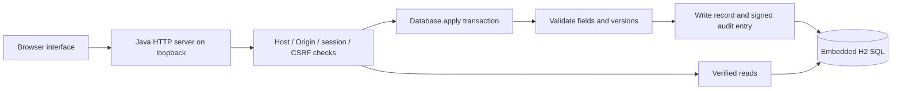

# Architecture

`Main` exposes a fixed API and packaged static files. `AuthService` owns in-memory sessions, cookie rotation, expiry, and login throttling. `Passwords` uses the JDK cryptography APIs. `Database` owns the JDBC connection, validation, transaction boundaries, concurrency checks, and audit integrity.

The account table supports exactly one owner. Its passphrase is hashed; the database's local connection password and the independent HMAC key are generated per workspace and stored in ignored key files. They are never source configuration.

Before a protected read or mutation, the database checks the sequential HMAC audit chain and compares the current canonical data fingerprint against the last signed event. A successful mutation writes the changed data and its audit event in one transaction. A failed validation or stale version rolls back without a partial record or note.

The browser sends a per-session CSRF token in a custom header. The session cookie is HttpOnly, so JavaScript cannot read its identifier. User text is escaped when inserted into the UI. The browser stores no record data or account credentials in localStorage or sessionStorage. On sign-out or expiry, its loaded private view is cleared.

The design protects application access on a single computer. It does not introduce separate staff roles or protect against an attacker who owns the local OS account, process, and keys. See [SECURITY.md](../SECURITY.md) for the exact boundary.
